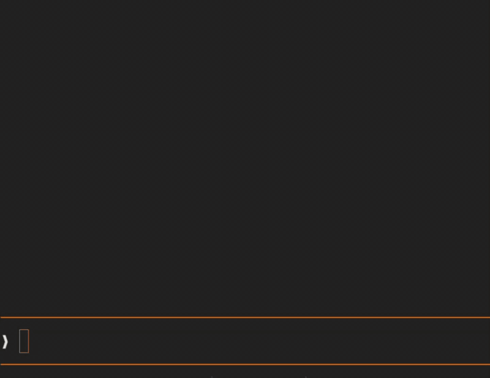

# claude-drop-thumb

A Claude Code mod that shows a `【#1 filename】` chip above the prompt for each dropped image, with a card (filename, pixel size, bytes, original path) and, on kitty-graphics terminals, a thumbnail.
The `[Image #1]` marker alone doesn't tell you what you pasted, so this mod puts the file's name and details one click or hover away.

[日本語](README.ja.md)

## When to use

- When you drop several images into one prompt and need to tell `[Image #1]` from `[Image #2]` before you send.
- When you want to check the dimensions, file size, or original path of a dropped image without leaving the prompt.
- When you use Ghostty or kitty and want a thumbnail of each dropped image right above the prompt.

Not for you if you are on Linux (untested), or if your Claude Code is older than v2.1.287. On Windows the chips and cards work, but there are no thumbnails (downscaling uses `sips`, a macOS tool).

## What it looks like

In Ghostty, dropping an image shows the chip; hovering over or clicking it opens the card with the thumbnail:



On terminals without kitty graphics, the same card appears without the thumbnail:

```
╭──────────────────────────────╮
│  #1                          │
│  201.jpg                     │
│  500× 500 px · 105 KB        │
│  ~/Downloads/201.jpg         │
╰──────────────────────────────╯
【#1 201.jpg】
❯ [Image #1]
```

## Install

From the marketplace:

```bash
claude plugin marketplace add i-noma-ru/claude-drop-thumb
claude plugin install drop-thumb@claude-drop-thumb
```

Try it once:

```bash
claude --plugin-dir /path/to/claude-drop-thumb
```

Load every time: Add to `env` in `~/.claude/settings.json` (multiple directories separated by `:`). Each entry can be the plugin folder itself, as below, or a folder that contains plugin folders (both confirmed in 2.1.292).

```json
{
  "env": {
    "CLAUDE_CODE_PLUGIN_DIRS": "/path/to/claude-drop-thumb"
  }
}
```

Takes effect starting from the next Claude Code launch.

## Requirements

- Claude Code v2.1.287 or later (mods support; a mod is a kind of Claude Code plugin, and commands and settings call it `plugin`)
- macOS or Windows. On Windows only the chips and cards appear, because thumbnails are downscaled with `sips`, a macOS tool. Linux is untested.

## Supported Terminals

| Terminal | Chip / Card | Thumbnail |
| --- | --- | --- |
| Ghostty, kitty | Shown | Shown |
| Orca 1.4.229 or later, with `CLAUDE_CODE_FORCE_TERMINAL_IMAGES=1` | Shown | Shown |
| Others (Terminal.app, iTerm2, older Orca, etc.) | Shown | Not shown (text info only) |
| Terminals on Windows (including Orca) | Shown | Not shown (text info only) |

Thumbnails are rendered using Claude Code's `Image` element. Claude Code renders images when the terminal name is `kitty` or `ghostty`, or on any terminal when `CLAUDE_CODE_FORCE_TERMINAL_IMAGES=1` is set; this mod draws thumbnails under the same conditions.
Orca (an Electron-based terminal app built on xterm.js) renders kitty Unicode-placeholder images from 1.4.229 (checked on 1.4.243, macOS). Orca can drop images after a tab switch (stablyai/orca#30383), so with the flag set this mod passes the thumbnail as a file and asks the terminal to re-read it on click and every 2 seconds. Do not set the flag on older Orca: the rendering breaks.

## Behavior

- Dropping an image displays `【#n filename】` chips right above the prompt.
- Clicking a chip opens its card above the chip, and clicking again closes it. It also opens on hover in environments where the terminal passes mouse movement events. The chips stay on the bottom row, so they do not move when a card opens or closes.
- Card contents: Thumbnail (kitty-compatible terminals only), filename, `width× height px`, file size in bytes, and the path of the original file (the home directory is shown as `~`).
- Submitting the prompt or deleting the `[Image #n]` marker removes the chips and card.

## Supported Image Formats

PNG, JPEG, GIF, WebP, BMP.
Follows the extensions that Claude Code itself accepts as "images" in the prompt (formats like HEIC, TIFF, and SVG do not become `[Image #n]` in the first place). For GIFs, only the first frame is displayed as a thumbnail.

## How It Works

1. Claude Code saves dropped images to a temporary directory `<temp>/<project>/<session id>/images/<n>.<ext>` and places only an `[Image #n]` marker in the prompt. The temporary directory is `CLAUDE_CODE_TMPDIR`, or otherwise `/tmp/claude-<uid>` on macOS and `%TEMP%\claude` on Windows (Windows checked on 2.1.312). Because dropping does not trigger an edit event, the mod inspects the prompt every 200 ms to detect markers.
2. Pixel dimensions are read from the first bytes of the image file (the PNG, JPEG, GIF, WebP, or BMP header). On terminals that can draw thumbnails, the image is downscaled to a 512 px PNG with `sips` (built into macOS) and passed to the `Image` element.
3. Because the saved image has identical bytes to the original file, the mod looks for files of the same size and compares their contents to determine the original path. On macOS it asks Spotlight (`mdfind`) first; when that finds nothing, as well as on Windows, it looks two levels deep in `Downloads`, `Desktop`, `Pictures`, and `Documents` under the home folder.

## What the plugin runs, reads, writes, and submits

This section lists everything the plugin executes and touches, for review. Nothing leaves the machine, and the plugin never submits a prompt or puts text into the prompt.

**Commands it runs:** all built into macOS, always with fixed arguments and local paths. On Windows they fail to start, and the mod goes on without them.

- `id -u` — only when neither `CLAUDE_CODE_TMPDIR` nor `%TEMP%\claude` exists, to build the `/tmp/claude-<uid>` path.
- `mkdir -m 700 -p <thumbDir>` and `test -d <thumbDir> -a ! -L <thumbDir>` — only on terminals that can draw thumbnails; create and verify the owner-only thumbnail folder.
- `sips -s format png -Z 512 <image> --out <thumb>` — only on terminals that can draw thumbnails; downscale the dropped image.
- `sips -g pixelWidth -g pixelHeight <image>` — only for images over 4 MiB, to read their dimensions (a mod can read files of at most 4 MiB).
- `mdfind "kMDItemFSSize == <bytes>"` — ask Spotlight for files of the same size (3 s timeout).
- `cmp -s <cached> <candidate>` — only for images over 4 MiB, to compare bytes for at most 5 candidates.

**What it reads:**

- the prompt text (to find `[Image #n]` markers)
- the dropped images in Claude Code's temporary directory
- the thumbnails it wrote
- the listings of `Downloads`, `Desktop`, `Pictures`, and `Documents` under the home folder, two levels deep (when Spotlight finds nothing)
- the environment variables `CLAUDE_CODE_TMPDIR`, `TEMP`, `USERPROFILE`, `HOME`, `TERM_PROGRAM`, and `CLAUDE_CODE_FORCE_TERMINAL_IMAGES`
- the bytes of up to 5 same-sized candidate files (to tell which one is the original)

**What it writes:** 512 px PNG thumbnails under `drop-thumb/` inside Claude Code's user-specific temporary directory (mode `0700`). Nothing else.

**What it submits:** nothing. The plugin hooks `prompt.submit` only to clear its own chips when you send a prompt; it never calls the model and never submits or edits a prompt.

## Privacy & Security

No network communication is performed. The mod only reads images in Claude Code's temporary directory and the contents of candidate files with matching sizes (for comparison). It only writes thumbnails placed in `drop-thumb/` inside Claude Code's user-specific temporary directory (`0700`, readable only by the owner). It never writes directly to the shared `/tmp` root. Running `claude plugin validate <directory>` lets you inspect the list of hooked events and invoked APIs.

## Limitations

- Images pasted directly from the clipboard have no original file, so the chip shows `(pasted image)`.
- Because the thumbnail line count is estimated assuming a cell aspect ratio of 0.45, vertical padding may remain depending on your terminal and font.
- When multiple files have identical sizes, the first file whose contents match is treated as the original file.
- On Windows, images over 4 MiB show neither their dimensions nor their original file name (the chip says `(pasted image)`): a mod can read files of at most 4 MiB, and there is no `sips` to read dimensions or `cmp` to compare bytes.

## Development

```bash
claude plugin validate .   # Inspect configuration and invoked APIs
claude plugin test .       # Run hooks/*.test.ts
tsc -p .                   # Type check after loading once (.claude-plugin/types/ is generated)
```

## Acknowledgements

The approach of "polling the prompt field and using Claude Code's cached image because dropping does not trigger an edit event" was learned from [jarrodwatts/claude-image-view](https://github.com/jarrodwatts/claude-image-view) (MIT). The code in this repository was written independently and does not include code from that project.

## License

MIT. Full text in `LICENSE`.
